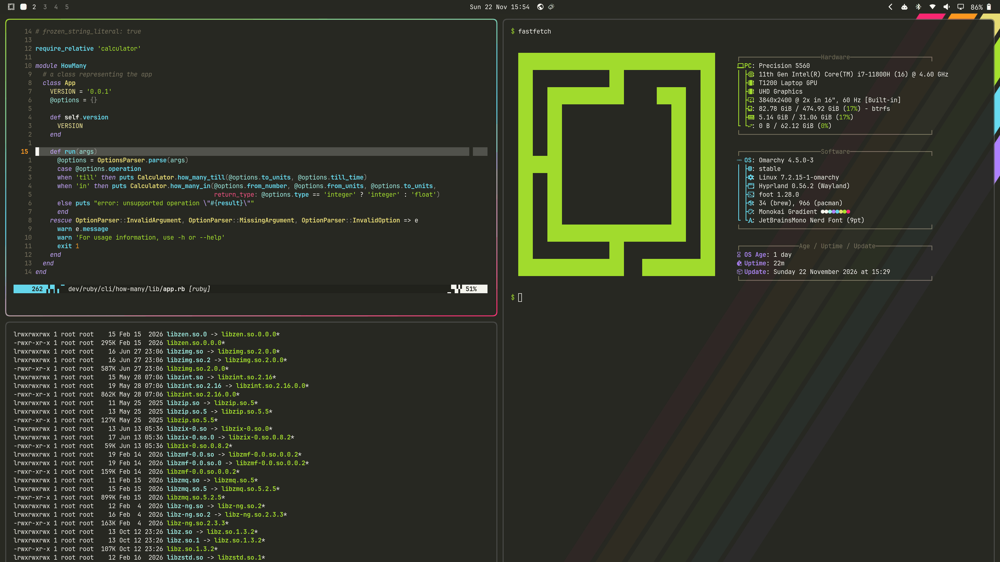

# Monokai Gradient

A dark Monokai theme for [Omarchy](https://omarchy.org), built on the classic Monokai palette, with a gradient window border and original wallpapers.



## Install

```bash
omarchy theme install https://github.com/jaapie/omarchy-monokai-gradient-theme
```

Then pick **Monokai Gradient** in the theme switcher, or run `omarchy theme set monokai-gradient`.

## What's included

- **Gradient border:** the focused window has a green → cyan → pink border at 45°.
- **Wallpapers:** two original backgrounds, *Stripes* and *Glow*.
- **Apps:** Neovim, terminals and the rest of Omarchy pick up the palette automatically.

## See also

[Monokai Gradient Light](https://github.com/jaapie/omarchy-monokai-gradient-light-theme), the light version.

## Licence

MIT
